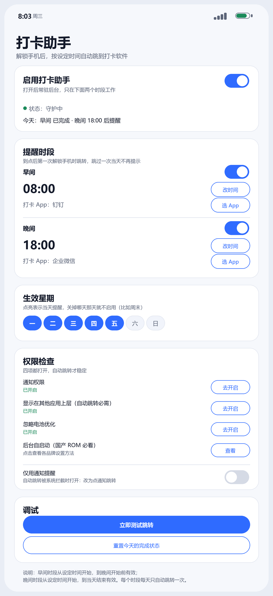
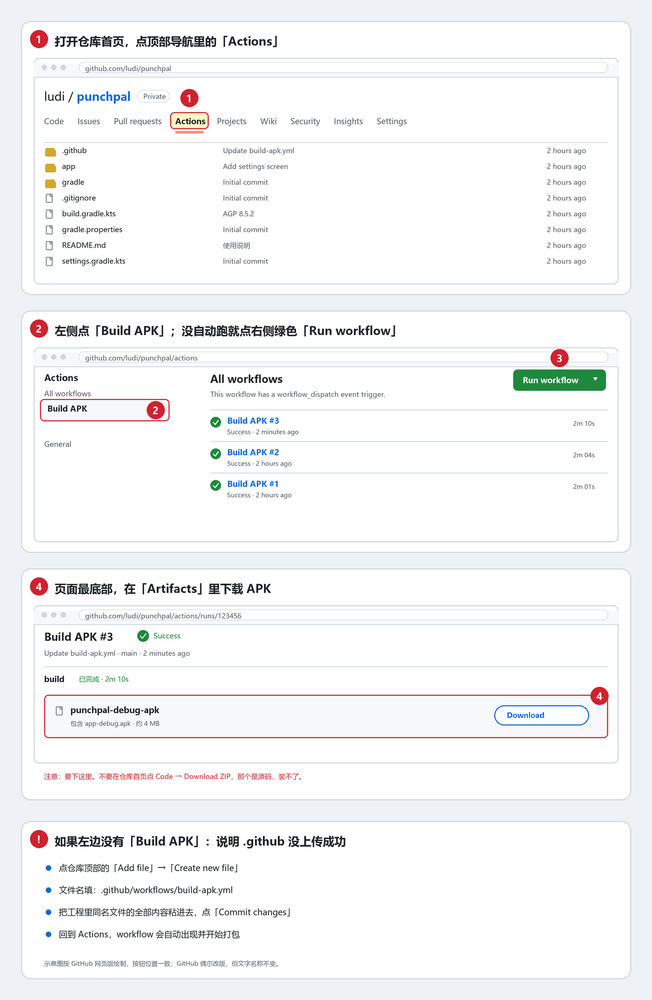

# 打卡助手（PunchPal）

一个只在本地运行的安卓小工具：**每天到点后第一次解锁手机，自动跳到你要打卡的那个 App；当天这个时段跳过一次，就不再提示。**

- 两个时段：默认 **08:00 之后**、**18:00 之后**，时间可自己改
- 每个时段可以**分别选择**要跳转的打卡 App（比如早上钉钉、晚上企业微信）
- 跳转成功后写入「今日已完成」，同一天同一时段不再打扰
- **生效星期**：七个开关，关掉哪天，那天就完全不启用（例如周末）
- 总开关 + 通知权限 / 悬浮窗 / 电池优化 / 自启动 四项检查
- 纯本地：没有 INTERNET 权限，不联网、不上传任何数据



> 上图为界面示意图，与 App 内实际布局一致。

> 说明：本工程已按 Android 10+ 的后台限制做了适配，但「解锁后自动打开别的 App」属于系统敏感能力，
> 需要授予**悬浮窗**权限；部分国产 ROM 还需要额外打开「自启动 / 后台弹出界面」。文末有逐条说明。

---

## 一、先拿到 APK（三种方式，任选一种）

### 方式 A：GitHub Actions 自动打包（推荐，不用装任何开发环境）

1. 注册 / 登录 [GitHub](https://github.com)。
2. 新建一个仓库（Private 也可以），名字随意，例如 `punchpal`。
3. 把本工程**根目录下的所有内容**上传到仓库根目录：
   - 解压 `punchpal.zip` 后，进入 `punchpal` 文件夹，全选里面的文件/文件夹（`app`、`gradle`、`.github`、`build.gradle.kts` 等）拖进 GitHub 的 “uploading an existing file” 页面；
   - 注意：`settings.gradle.kts` 必须位于仓库根目录，不要多套一层文件夹。
   - 小提示：`.github` 是隐藏文件夹，网页拖拽可能会漏掉。上传完成后如果仓库里看不到 `.github/workflows/build-apk.yml`，
     点 **Add file → Create new file**，文件名填 `.github/workflows/build-apk.yml`，把本工程里这个文件的内容原样粘进去即可。
4. 上传完成后，仓库顶部 **Actions** → 左侧 **Build APK** → 等待 3～5 分钟变成绿色对勾。
5. 点进这次运行，页面底部 **Artifacts** → 下载 `punchpal-debug-apk.zip`。
6. 解压得到 `app-debug.apk`，发到手机安装（需要允许「安装未知来源应用」）。

> 每次改完代码推送到 `main` 分支，都会自动重新打包。



> 上图是「Actions 在哪、Build APK 在哪、APK 在哪下载」的位置示意。

### 方式 B：Android Studio 本地打包

1. 安装 [Android Studio](https://developer.android.com/studio)（安装时勾选 Android SDK Platform 34）。
2. `File → Open`，选择本工程根目录。
3. 如果提示缺少 Gradle wrapper：`Settings → Build, Execution, Deployment → Build Tools → Gradle`，
   把 “Use Gradle from” 改为 **Local installation**（需本机安装 Gradle 8.7），
   或在 Terminal 里执行一次 `gradle wrapper --gradle-version 8.7`。
4. `Build → Build Bundle(s) / APK(s) → Build APK(s)`。
5. 产物：`app/build/outputs/apk/debug/app-debug.apk`。

### 方式 C：命令行

```bash
# 需要 JDK 17 + Android SDK 34 + Gradle 8.7
gradle assembleDebug
# 或已有 wrapper 时
./gradlew assembleDebug
```

---

## 二、首次使用（4 步）

1. **打开总开关**「启用打卡助手」。
   - 第一次会申请通知权限，请选「允许」。
2. **权限检查**里四项逐个点「去开启」：
   - **通知权限**：前台服务通知 + 到点提醒都需要；
   - **显示在其他应用上层**：安卓 10 以后，App 在后台想启动别的界面，必须有这个权限，否则只能发通知；
   - **忽略电池优化**：防止系统把常驻服务冻结；
   - **后台自启动**：按机型给的操作路径设置（小米 / 华为 / 荣耀 / OPPO / vivo / 三星都写了）。
3. **选打卡 App**：早间、晚间各点一次「选 App」，从手机已安装应用里选。
4. **改时间 / 关星期**（可选）：默认 08:00、18:00；七个圆点里关掉不想提醒的日子（比如周六周日）。

最后点一次 **「立即测试跳转」** 验证：能直接跳到打卡 App 就说明权限齐了；
如果只弹出通知，说明自动跳转被系统拦住了 —— 去补「悬浮窗 / 后台弹出界面」权限，或打开「仅用通知提醒」。

---

## 三、它到底怎么工作

```
开机 / 打开开关
      │
      ▼
TriggerService（前台常驻，带一条不打扰的常驻通知）
      │  监听：ACTION_USER_PRESENT（解锁完成）、ACTION_SCREEN_ON、ACTION_SCREEN_OFF
      │  兜底：每 20 秒轻量检查一次
      ▼
判定链：总开关 → 今天星期几是否启用 → 当前是否处于某个时段
        → 今天该时段是否已完成 → 目标 App 是否存在 → 手机是否已解锁且亮屏
      ▼
自动跳转（需要悬浮窗）──失败──▶ 全屏/高优先级通知，点一下跳转
      │                                   │
      ▼                                   ▼
写入 done_date_<时段> = 今天         点通知后由 LaunchProxyActivity 写入
      │
      ▼
当天该时段不再提示；次日 0 点后日期不匹配，自动恢复
```

关键实现点：

| 需求 | 实现 |
| --- | --- |
| 解锁才跳，不打扰正在用手机的人 | 只在 `ACTION_USER_PRESENT` 后 90 秒内判定；定时兜底也要求「刚刚解锁过」 |
| 每天 8 点后、18 点后各一次 | 两个时段窗口：早间 = 08:00 → 晚间开始前；晚间 = 18:00 → 当天结束 |
| 跳过一次当天不重复 | `SharedPreferences` 记录 `done_date_morning` / `done_date_evening`，值为日期字符串 |
| 选择跳转哪个软件 | 列出所有带桌面图标的 App，可搜索，早间/晚间分开存 |
| 哪天不开启 | 七个星期开关，默认全开；关闭当天直接 return，不判定、不提示 |
| 重启后仍然生效 | `BOOT_COMPLETED` 广播拉起服务（需自启动权限） |

时间窗口示例（默认值）：

```
00:00 ─────── 08:00 ─────────────── 18:00 ─────────── 24:00
              早间窗口              晚间窗口
```

把早间改成 09:30，则 09:30 前解锁不会提示；如果晚间关闭，早间窗口会一直持续到当天结束。

---

## 四、权限说明

| 权限 | 为什么需要 | 不给会怎样 |
| --- | --- | --- |
| `POST_NOTIFICATIONS` | 前台服务通知、到点提醒 | 服务仍在跑，但看不到提醒 |
| `SYSTEM_ALERT_WINDOW`（悬浮窗） | 安卓 10+ 允许后台启动界面的豁免条件 | 只能发通知，不能自动跳转 |
| `FOREGROUND_SERVICE` / `FOREGROUND_SERVICE_SPECIAL_USE` | 常驻服务保活 | 服务无法常驻 |
| `RECEIVE_BOOT_COMPLETED` | 重启后自动恢复 | 重启后要手动打开一次 App |
| `REQUEST_IGNORE_BATTERY_OPTIMIZATIONS` | 引导关闭电池优化 | 息屏久了服务可能被冻结 |
| `USE_FULL_SCREEN_INTENT` | 通知模式下尽量全屏提醒 | 只显示普通通知 |
| `QUERY_ALL_PACKAGES`（未使用） | — | 只通过 `<queries>` 查询桌面 App，不申请全部包可见性 |
| `INTERNET`（**未申请**） | — | 无法联网，代码里也没有任何网络请求 |

---

## 五、常见问题

**Q1：到点了，解锁后没有跳转？**
按顺序检查：
1. 顶部总开关是否打开；
2. 对应时段的小开关是否打开；
3. 今天星期几的圆点是否点亮；
4. 「今天」一行是否已显示「已完成」（可以点「重置今天的完成状态」再测）；
5. 是否是**解锁之后**才触发的（如果你 7:50 就解锁、一直用到 8:10，不会在 8:00 突然跳走，要等下一次解锁）；
6. 悬浮窗权限是否真的给了；
7. 小米/华为等是否开了自启动、后台弹出界面、省电无限制。

**Q2：跳转成功，但状态没变成「已完成」？**
自动跳转是「调用系统接口后即视为完成」，个别 ROM 会在系统层静默拦截。判断办法：
如果跳转后没有真正打开打卡 App，就打开 **「仅用通知提醒」**，走「点通知 → 打开成功后才标记完成」的可靠路径。

**Q3：为什么通知不是全屏弹出？**
Android 14 起，全屏通知只默认授予通话/闹钟类应用，普通应用会降级为横幅提醒。点一下横幅同样能跳转。

**Q4：会不会很耗电？**
常驻服务每 20 秒做一次纯本地判断（不唤醒 CPU、不联网），耗电可以忽略；真正耗电的是部分 ROM 的「后台弹出」限制导致的反复拉起，按 Q1 设置好即可。

**Q5：重启手机后失效？**
需要「自启动」权限。授予后 `BootReceiver` 会自动拉起服务；没有权限时，打开一次 App 也会自动恢复。

**Q6：想改成三个时段 / 只工作日？**
- 只工作日：把周六、周日的圆点关掉即可（现有功能就能做到）。
- 三个时段：在 `Slot.kt` 里加一个枚举值（如 `NOON("noon", "午间", 12*60)`），
  `activity_main.xml` 里复制一组早晚间的控件，`Prefs` 与 `TriggerService` 会自动适配（代码按 `Slot.values()` 遍历）。

---

## 六、已知限制（务必了解）

1. **不能在锁屏上直接跳转**：必须真正解锁进入桌面后触发，这是系统安全限制。
2. **Android 10+ 后台启动界面受限**：悬浮窗权限是目前免 root 方案里最通用的豁免方式；部分 ROM（尤其 Android 14 的 Pixel / 原生系统）仍可能拦截，此时请用通知模式。
3. **国产 ROM 差异大**：MIUI / HyperOS、EMUI、ColorOS、OriginOS 都有独立的「自启动 / 后台弹出界面 / 锁屏显示」开关，不设置的话服务会被杀。
4. **打卡 App 自身的启动广告**：跳过去之后先看到的是它自己的开屏页，这是对方 App 的行为，本工具无法跳过。
5. **只在「解锁」这一时刻触发**：如果你 7:59 解锁后一直亮屏使用到 8:30，期间不会突然跳走（避免打断使用），下次解锁才会触发。这是刻意设计，不是 bug。
6. **没有上架应用商店**：debug 签名，自己安装使用即可；不要用这个包直接发布。

---

## 七、工程结构

```
punchpal/
├── .github/workflows/build-apk.yml   # GitHub Actions 一键出 APK
├── app/
│   ├── build.gradle.kts
│   └── src/main/
│       ├── AndroidManifest.xml
│       ├── java/com/punchpal/app/
│       │   ├── App.kt                 # 通知渠道初始化
│       │   ├── MainActivity.kt        # 设置界面
│       │   ├── Slot.kt                # 时段枚举 + 时间窗口判定
│       │   ├── Prefs.kt               # 所有设置 / 完成状态
│       │   ├── TriggerService.kt      # 解锁监听 + 判定 + 跳转
│       │   ├── Notifications.kt       # 前台服务通知 / 到点提醒
│       │   ├── LaunchProxyActivity.kt # 点通知后的跳板，标记完成再启动目标 App
│       │   ├── AppPickerDialog.kt     # 已安装应用选择器（可搜索）
│       │   ├── AppLauncher.kt         # 兼容解析目标 App 启动入口
│       │   └── BootReceiver.kt        # 开机自启
│       └── res/                       # 布局、主题、图标
├── gradle/wrapper/gradle-wrapper.properties
├── build.gradle.kts
├── settings.gradle.kts
└── README.md
```

---

## 八、隐私

- 没有 `INTERNET` 权限，代码里没有任何网络调用；
- 不读取通讯录、短信、位置、相册；
- 所有设置只存在本机 `SharedPreferences`；
- 唯一的「读取应用列表」是为了让你选打卡 App，通过 `<queries>` 只查询有桌面图标的 App。

---

## 九、技术参数

| 项 | 值 |
| --- | --- |
| 语言 | Kotlin 1.9.24 |
| Android Gradle Plugin | 8.5.2（Gradle 8.7，JDK 17） |
| compileSdk / targetSdk | 34 |
| minSdk | 26（Android 8.0） |
| UI | Material 3 + 原生 View |
| 依赖 | core-ktx、appcompat、material、recyclerview、activity-ktx |

> 如果你的手机是 Android 8.0 以下，或者你用的是 iPhone：前者装不上，后者系统根本不允许「解锁后自动打开别的 App」，
> 只能用「快捷指令 + 到点通知」的半自动方案。
